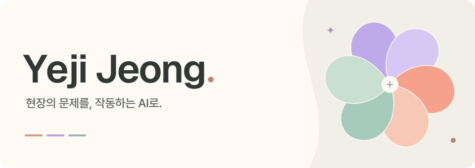

  <a href="https://dpwld.github.io/">Portfolio ↗</a>&nbsp;&nbsp; · &nbsp;&nbsp;<a href="https://www.linkedin.com/in/yejijeong1204/">LinkedIn ↗</a>

금융 실무와 AI 연구를 바탕으로 업무 자동화와 LLM 시스템을 만듭니다. 
사용자의 요구를 데이터 흐름과 기능으로 구체화하는 **Forward Deployed Engineering**을 지향합니다.

 

경험과 기술

 

**금융 실무** — 삼성증권에서 고객 응대, 운용 지원, 정산과 예산 업무를 경험했습니다. 
**업무 자동화** — 스타트업의 업무 맥락을 바탕으로 AI 도구와 웹 서비스를 만들고 운영합니다. 
**AI 연구** — 감성분석 프롬프트 실험, 모델 도입 검토, 연구 파이프라인 구축에 참여했습니다.

 

**Languages** &nbsp; Python · JavaScript · TypeScript · R 
**Applications** &nbsp; React · Next.js · Node.js · Supabase · SQLite 
**AI &amp; Data** &nbsp; LLM API · 프롬프트 평가 · 에이전트 워크플로우 · 데이터 시각화

