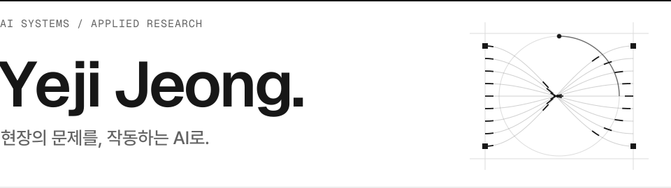

<picture>
  <source media="(prefers-color-scheme: dark)" srcset="assets/header-dark.svg">
  <source media="(prefers-color-scheme: light)" srcset="assets/header-light.svg">
  
</picture>

  <samp><a href="https://dpwld.github.io/">PORTFOLIO ↗</a>&nbsp;&nbsp; / &nbsp;&nbsp;<a href="https://www.linkedin.com/in/yejijeong1204/">LINKEDIN ↗</a></samp>

금융 실무와 AI 연구를 바탕으로 업무 자동화와 LLM 시스템을 만듭니다. 
사용자의 요구를 데이터 흐름과 기능으로 구체화하는 **Forward Deployed Engineering**을 지향합니다.

 

<samp>SELECTED WORK / 주요 작업</samp>

### 01 &nbsp; 사내 AI 업무 시스템

사내 정보 조회와 반복 업무를 돕는 봇·대시보드를 구축합니다. 
LLM integration · Workflow automation · Internal tools

[프로젝트 소개 ↗](https://dpwld.github.io/#projects)

### 02 &nbsp; SSTR2 AI Scientist

펩타이드 후보 탐색을 위한 생성·필터링·대리 모델·LLM 에이전트 연구 파이프라인입니다. 
Python · Research pipelines · LLM agents

[저장소 보기 ↗](https://github.com/dpwld/SSTR2_AI_SCIENTIST_KAERI)

### 03 &nbsp; SwirlX Design

기술 보고서의 차트와 표를 일관된 스타일로 만드는 Claude Code 플러그인입니다. 
JavaScript · Data visualization · Developer tools

[저장소 보기 ↗](https://github.com/dpwld/swirlx-design)

 

<samp>BACKGROUND &amp; TOOLKIT / 경험과 기술</samp>

 

**금융 실무** — 삼성증권에서 고객 응대, 운용 지원, 정산과 예산 업무를 경험했습니다. 
**업무 자동화** — 스타트업의 업무 맥락을 바탕으로 AI 도구와 웹 서비스를 만들고 운영합니다. 
**AI 연구** — 감성분석 프롬프트 실험, 모델 도입 검토, 연구 파이프라인 구축에 참여했습니다.

 

**Languages** &nbsp; Python · JavaScript · TypeScript · R 
**Applications** &nbsp; React · Next.js · Node.js · Supabase · SQLite 
**AI &amp; Data** &nbsp; LLM API · 프롬프트 평가 · 에이전트 워크플로우 · 데이터 시각화

